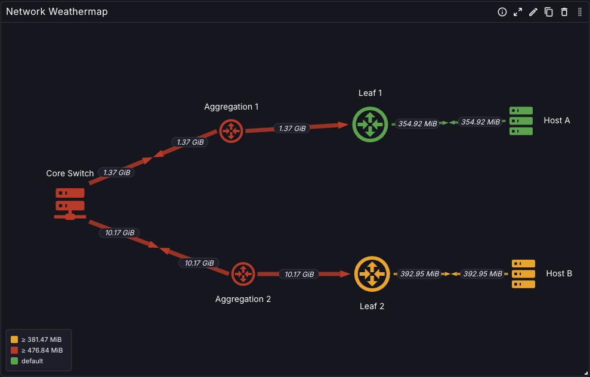

# Canvas

The Canvas plugin draws free-form diagrams in Perses dashboards: nodes connected by edges, over
optional background shapes and images. Nodes and edges can be colored by query-bound thresholds,
labeled with live metric values, and (for edges) scaled in thickness by value. This makes it a
general-purpose diagramming panel — architecture and topology maps, flow and dependency diagrams,
annotated floor plans, and weathermap-style network/traffic views are all common use cases.

The panel has two modes, selected in the panel's **Settings** editor under **Items**:

- **Manual** — draw the graph by hand: place nodes, connect them with edges, and add background
  shapes or images. Each node and edge can bind to a query to drive its color, size/thickness, and
  label.
- **Generated** — generate the graph live from query results and lay it out automatically. Use this
  for dynamic topologies (for example, frequently changing service or host relationships) where
  drawing by hand is not feasible.

See also technical docs related to this plugin:

- [Data model](./model.md)
