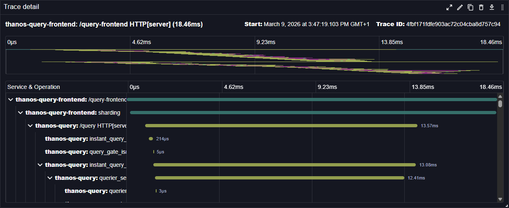

# Tracing Gantt Chart

The Tracing Gantt Chart plugin provides Gantt chart visualization for distributed tracing data in Perses dashboards. This panel plugin displays trace spans in a timeline format, making it easy to visualize trace duration and dependencies.



See also technical docs related to this plugin:

- [Data model](./model.md)
- [Dashboard-as-Code Go lib](./go-sdk.md)

## Item actions

Item actions let you trigger events or webhooks with the details of a span, for example to open the logs of a span in another plugin or application.
Actions are configured in the **Item Actions** tab of the panel editor:

- **Enable Item Selection**: adds a checkbox to each span row, and a checkbox in the table header to select all spans of the trace.
  The checked spans are exposed as the panel selection. The selection is cleared when another trace is loaded.
- **Display Actions with Each Item**: shows the actions as buttons in the span detail pane, below the span name.
  These actions are executed with the span opened in the detail pane only.
- **Display Actions in Panel Header**: shows the actions in the panel header. Requires **Enable Item Selection**:
  these actions are executed with the checked spans, either once per span (`individual` batch mode) or once for all spans (`batch` batch mode).

Each action receives the data of a span and its trace, as `{ "span": { ... }, "trace": { ... } }`.
Fields can be referenced in URL and body templates with `${__data.fields["<path>"]}`, e.g. `${__data.fields["span.name"]}`:

| Field                                              | Description                                            |
|----------------------------------------------------|--------------------------------------------------------|
| `span.traceId`, `span.spanId`, `span.parentSpanId` | Identifiers of the trace, span and parent span         |
| `span.name`, `span.kind`                           | Span name and span kind                                |
| `span.startTimeUnixMs`, `span.endTimeUnixMs`       | Start and end time of the span, in milliseconds        |
| `span.status.code`, `span.status.message`          | Span status                                            |
| `span.scope.name`, `span.scope.version`            | Instrumentation scope                                  |
| `span.resource.serviceName`                        | Service name                                           |
| `span.resource.attributes`, `span.attributes`      | Resource and span attributes, as OTLP key-value lists  |
| `span.events`, `span.links`                        | Span events and links, with their attributes           |
| `trace.traceId`, `trace.spanCount`                 | Identifier of the trace and its number of spans        |
| `trace.startTimeUnixMs`, `trace.endTimeUnixMs`     | Start and end time of the whole trace, in milliseconds |

Object fields are interpolated as JSON, e.g. `${__data.fields["span.attributes"]}`.
Attributes are lists of OTLP key-value pairs (e.g. `[{ "key": "http.method", "value": { "stringValue": "GET" } }]`),
so they cannot be referenced individually with a field path: use the whole list, or the full data with `${__data:json}`.

An event action dispatches a [`CustomEvent`](https://developer.mozilla.org/en-US/docs/Web/API/CustomEvent) on `window`, allowing any plugin or application to handle it.
Without body template, the event detail is the JSON of `{ "id": <spanId>, "data": { "span": ..., "trace": ... } }`:

```ts
window.addEventListener('span-logs', (event) => {
  const { data } = JSON.parse((event as CustomEvent<string>).detail);
  openLogs({ traceId: data.span.traceId, spanId: data.span.spanId, service: data.span.resource.serviceName });
});
```
