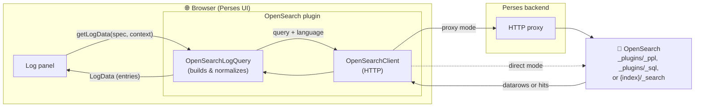
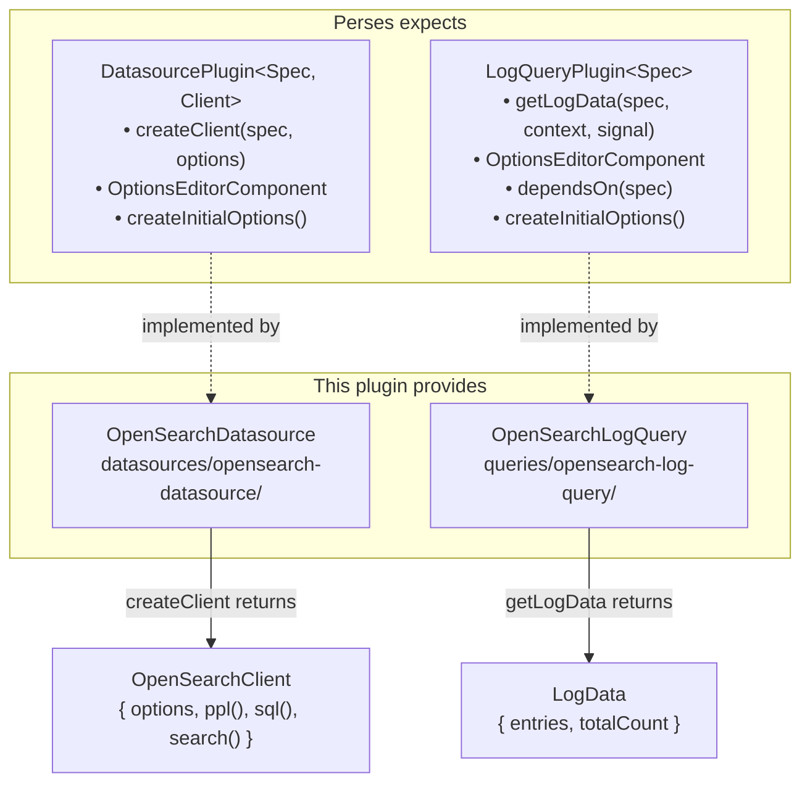
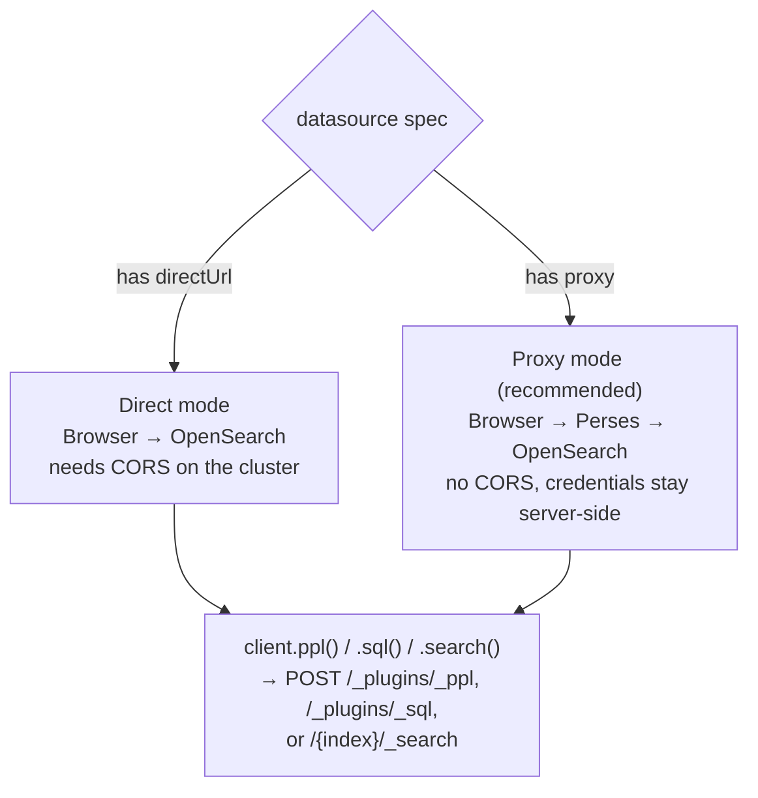
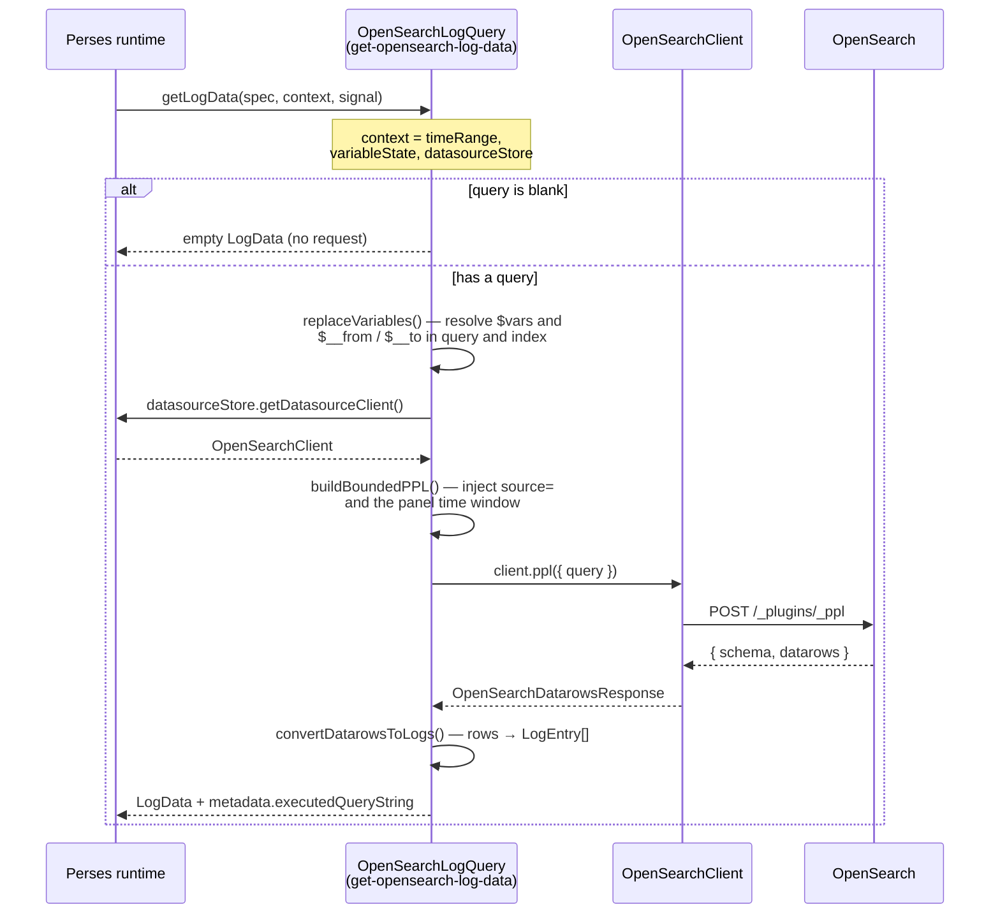
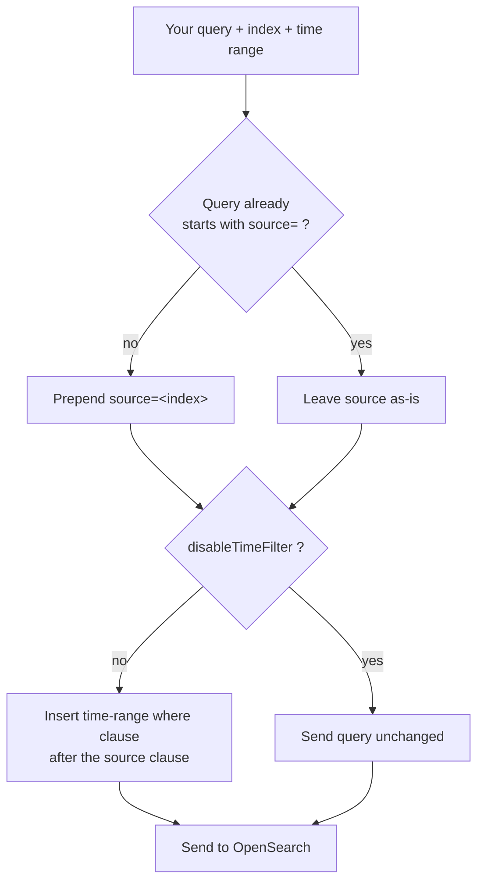
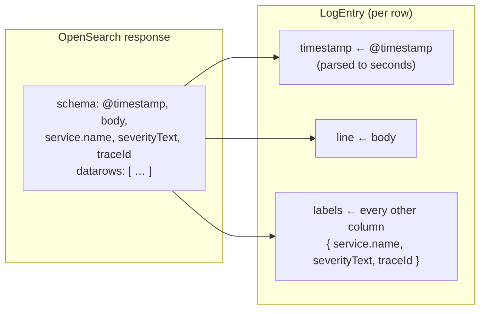
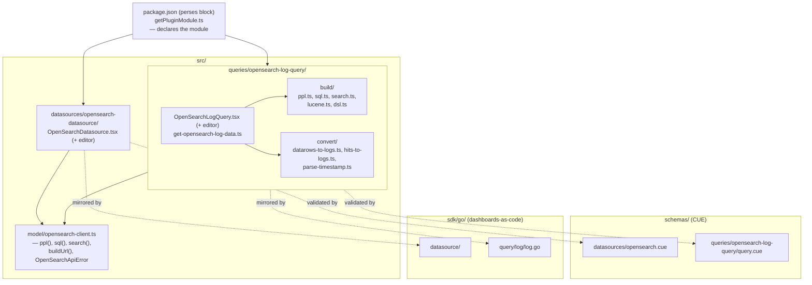

# How the OpenSearch plugin works

This document explains the internals of the OpenSearch plugin: what it is, how it
plugs into Perses on one side and OpenSearch on the other, and what happens —
step by step — when a log panel asks for data.

If the [user guide](./using-opensearch-in-perses.md) is "how do I use it", this is
"how does it actually work".

## The one-sentence model

> **A Perses plugin is a set of TypeScript contracts on the Perses side and one of
> three HTTP calls on the OpenSearch side. This plugin's whole job is the
> translation in between: turn a query — written in PPL, SQL, Lucene, or Query
> DSL — typed into a panel into log lines fetched from a cluster, and turn
> whichever of the cluster's two answer shapes that language returns back into
> something Perses can render.**

Keep that sentence in mind — every part below is a detail of it.

## What the plugin actually is

The package `@perses-dev/opensearch-plugin` publishes **one plugin module** named
`OpenSearch`. That module registers **two plugins** that Perses loads and uses
independently:

| Plugin | Kind | Responsibility |
| --- | --- | --- |
| `OpenSearchDatasource` | `Datasource` | Knows *how to reach* a cluster. Produces a client. |
| `OpenSearchLogQuery` | `LogQuery` | Knows *how to ask* for logs with PPL, SQL, Lucene, or Query DSL and normalize the answer. |

They are declared in the `perses` block of `package.json`, and everything else in
the repo exists to support these two.

## The big picture

Here is the whole system in one view. The browser runs the Perses UI; the plugin
code runs *inside* that browser; and it reaches OpenSearch either directly or
through the Perses backend proxy.



The request goes **down** the left edge (panel → query → client → OpenSearch) and
the data comes **back up** (OpenSearch → client → query → panel). The two arrows
into OpenSearch are the two connection modes — more on that below.

## How it plugs into Perses

Perses does not know OpenSearch exists. It only knows two interfaces from
`@perses-dev/plugin-system`. The plugin implements them, and Perses calls the
implementations at the right moments.



The two return types are the contract in practice:

- **`OpenSearchDatasource.createClient`** returns an `OpenSearchClient` — an object
  with three methods, `ppl()`, `sql()`, and `search()`, one per OpenSearch
  transport. The query plugin calls whichever one matches the query's resolved
  language; that is the only thing it ever needs from the datasource.
- **`OpenSearchLogQuery.getLogData`** returns `LogData` — the normalized
  `{ entries, totalCount }` shape from `@perses-dev/spec` that Perses log panels
  know how to render.

The same query spec is also mirrored as a **CUE schema** (for server-side
validation) and a **Go SDK struct** (for defining dashboards as code), so the UI,
the backend, and dashboards-as-code all agree on the shape.

## How it reaches OpenSearch

The plugin talks to one of **three endpoints**, chosen by the query's language,
and gets back one of **two response shapes**:

| Language(s) | Endpoint | Response shape |
| --- | --- | --- |
| PPL | `POST /_plugins/_ppl` | `{ schema, datarows }` — a table |
| SQL | `POST /_plugins/_sql` | `{ schema, datarows }` — a table |
| Lucene, Query DSL | `POST /{index}/_search` | `{ hits: { hits: […] } }` — documents |

For example, a PPL request/response pair:

```
Request:   POST /_plugins/_ppl   { "query": "source=logs-* | head 20" }
Response:  { "schema": [ { "name", "type" }, … ],
             "datarows": [ [ v, v, v ], … ] }
```

PPL and SQL share the tabular `datarows` shape because both go through the
SQL/PPL plugin; Lucene and Query DSL bypass it and hit the core `_search` API
directly, coming back as hits instead of rows. That split is why there are two
converters rather than one (see below).

`createClient` decides *where* those POSTs go, based on the datasource spec —
the query language only picks *which* endpoint, not the connection mode:



Either way the query plugin calls whichever client method matches the resolved
language — only the resolved base URL differs, not the transport logic. If a
request fails, the client reads the error body and throws an
`OpenSearchApiError`, which pulls the actionable text out of OpenSearch's
`reason` / `details` fields (or, for `_search` failures, `root_cause[0].reason`)
so you get a diagnosable message instead of a bare status code.

## What happens when a panel loads — the full lifecycle

This ties both ends together. When a log panel needs data, Perses calls
`getLogData(spec, context, abortSignal)`. The shape of the call is the same for
every language — resolve variables, get a client, build a request, call
OpenSearch, convert the response — only the build/convert/client step in the
middle changes. Log queries receive only user-defined variables, so `getLogData`
adds the builtin `__from` / `__to` (the time range in epoch milliseconds) before
resolving them. Follow the default (PPL) path end to end:



Two of those steps do the real translating — a **build** step on the way out and
a **convert** step on the way back; here, `buildBoundedPPL` and
`convertDatarowsToLogs`. The other three languages take the same shape but swap
in their own builder and, for Lucene/Query DSL, a different converter. They are
worth understanding on their own.

## The outbound transform: `build/`

Every query language has its own builder in `build/` that turns the query spec
into whatever request shape its endpoint expects:

- **`ppl.ts` → `buildBoundedPPL`** — splices a `source=` clause and a
  time-bounded `where` clause into the PPL string.
- **`sql.ts` → `buildSqlRequest`** — adds a time-bounded condition to the outer
  query's `WHERE` clause (or inserts a `WHERE` before `GROUP BY` / `HAVING` /
  `ORDER BY` / `LIMIT`). It does not use the `_sql` API's `filter` field, which
  forces OpenSearch onto its legacy SQL engine.
- **`lucene.ts` → `buildLuceneSearchBody`** and **`dsl.ts` → `buildDslSearchBody`**
  — wrap the query string (Lucene) or parsed JSON body (Query DSL) in a
  `_search` request, ANDing in a `bool.filter` time-range clause. A Query DSL
  `query` is nested under `bool.must` so it keeps its scoring.
- **`search.ts`** — shared helpers used by the two `_search` builders above:
  `buildTimeRangeFilter`, `buildDefaultSort`, and `resolveSize` (the `limit` →
  `size` default, 500).

`buildBoundedPPL` is the most involved of the five, because the time bound has
to be spliced into a query string rather than added as a separate request
field. It is worth walking through in detail.

You almost never want *all* logs — you want the ones in the dashboard's time
range. Rather than make you write that clause every time, the plugin rewrites your
query before sending it. Two things get injected:

1. **A `source=` clause** from the *Index pattern* field — but only if you did not
   already write one yourself.
2. **A time bound** — a `where` clause on the timestamp field, bounded to the
   panel's current range, inserted **right after the source clause** so it runs
   before any pipe (like `stats`) that would drop the timestamp column.



So a query you write as:

```ppl
source=otel-logs-demo | where severityText='ERROR'
```

is sent (for a "last 60 minutes" range) as:

```ppl
source=otel-logs-demo
  | where `@timestamp` >= '2026-07-14T03:53:33.000Z' and `@timestamp` <= '2026-07-14T04:53:33.000Z'
  | where severityText='ERROR'
```

Because the index and timestamp field are user-editable, they are treated as
untrusted before being spliced into the string: `escapeIdentifier` doubles any
backtick in the timestamp field, `sanitizeIndex` strips characters that could open
a new PPL stage (`` ` ``, `|`, quotes, whitespace) from the index, and
`joinPPLStages` drops empty segments so there is never a dangling `… |`.

## The inbound transform: `convert/`

There are two converters, one per response shape:

- **`datarows-to-logs.ts` → `convertDatarowsToLogs`** — for PPL and SQL's
  tabular `{ schema, datarows }` response.
- **`hits-to-logs.ts` → `convertHitsToLogs`** — for Lucene and Query DSL's
  `_search` `{ hits }` response. It flattens each hit's `_source` document to
  dot-separated label keys (`flattenSource`), since a `LogEntry`'s `labels` is a
  flat map and `_source` is not.

Both share `parse-timestamp.ts`'s `parseTimestamp` to normalize whatever
timestamp value they pick to seconds.

OpenSearch answers with columns and positional rows (or, for `_search`, JSON
documents). Perses renders `LogEntry` objects, each with a `timestamp`, a `line`,
and a bag of `labels`. `convertDatarowsToLogs` bridges the tabular shape by
**picking** one column as the timestamp and one as the message, then sweeping
every other column into labels.



Which column is which is chosen by name, with fallbacks. Your query-level
`timestampField` / `messageField` overrides are tried first, then these defaults:

- **timestamp:** `@timestamp` → `timestamp` → `time`
- **message:** `message` → `log` → `body`

If no message column matches, the whole row is JSON-stringified into `line` so
nothing is lost. Timestamps are normalized to seconds by detecting the unit from
the value's magnitude (seconds / milliseconds / microseconds / nanoseconds), and
OpenSearch's zoneless `"2020-08-26 13:49:00"` datetimes are forced to explicit UTC
so the browser's local offset does not shift them.

## Where each concern lives



## Recap

- The plugin is **one module, two plugins**: a datasource (connection) and a log
  query (PPL, SQL, Lucene, or Query DSL + normalization).
- Perses talks to it through **two interfaces**; OpenSearch talks to it through
  **three endpoints** (`POST /_plugins/_ppl`, `POST /_plugins/_sql`, and
  `POST /{index}/_search`), which return one of **two response shapes**.
- At runtime, `getLogData` **resolves variables → gets a client → builds a
  language-specific request → calls the matching OpenSearch endpoint → converts
  the response to log entries**.
- The real logic lives in two directories: `build/` (five builders — one per
  language, plus `search.ts`'s shared `_search` helpers) and `convert/` (two
  converters — `convertDatarowsToLogs` for PPL/SQL, `convertHitsToLogs` for
  Lucene/Query DSL).
